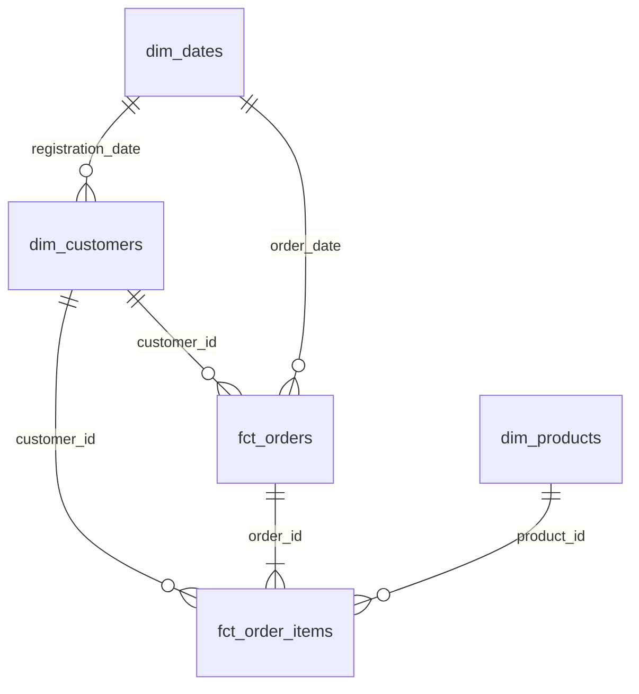
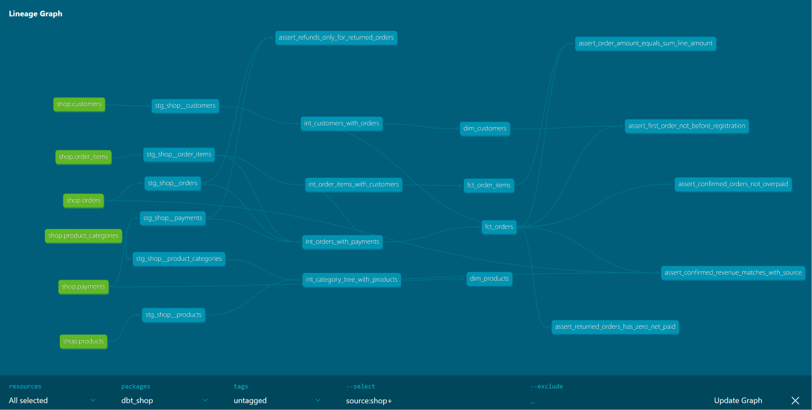

# Хранение в Greenplum

|relname|distribution|storage|
|-------|------------|-------|
|dim_customers|DISTRIBUTED REPLICATED|heap|
|dim_dates|DISTRIBUTED REPLICATED|heap|
|fct_orders|DISTRIBUTED BY (order_id)|ao_column|
|dim_products|DISTRIBUTED REPLICATED|heap|
|fct_order_items|DISTRIBUTED BY (order_id)|ao_column|

## Обоснование выбора

1. **Измерения и факты:**
   *   **dimensions** — в сравнении с facts небольшие таблицы, к которым часто будем обращаться, например, в джойнах, поэтому логичнее всего хранить их в каждой отдельной ноде для скорости выполнения запросов.
   *   **facts** — большие таблицы, используемые в аналитических запросах, поэтому для использования MPP логичнее всего их распределить по нодам в целях увеличения скорости запросов и распределения памяти. При этом, в силу того, что ключи дистрибуции у `fct_orders` и `fct_order_items` одинаковые, взаимодействие между таблицами будет более быстрым (Co-located Join).

2. **Связь с сырыми данными (raw):**
   Витрины `fct_orders`, `fct_order_items` и raw-tables: `orders`, `order_items`, `payments` имеют одинаковый ключ дистрибуции — `order_id`.

3. **Последствия разных ключей:**
   Во-первых, нарушится принцип Co-located Join. Во-вторых, при взаимодействии между двумя этими витринами будет большая нагрузка на сеть, из-за чего скорость запроса и общая пропускная способность упадут.

# Модель данных

## Зернистость витрин

* **`fct_orders`** - одна строка это один заказ. *Сколько подтвержденных заказов/сумма заказов?сколько refund заказов?*

* **`fct_order_items`** - одна строка это одна позиция в заказе. *Сколько и какие товары покупают?*

* **`dim_customers`** - один клиент. *Какой клиент и на какую сумму у нас покупает?*

* **`dim_products`** - один продукт. *Чей продукт и какого типа мы продаем?*

* **`dim_dates`** - одна дата. *Вспомогательная витрина.*

## ER - диаграмма

## Граф Lineage

